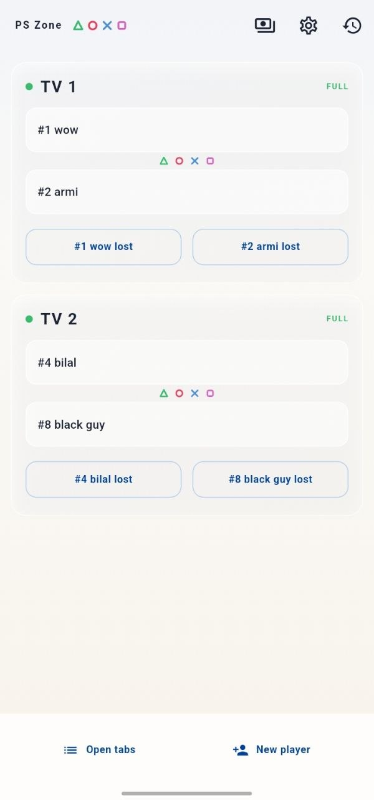
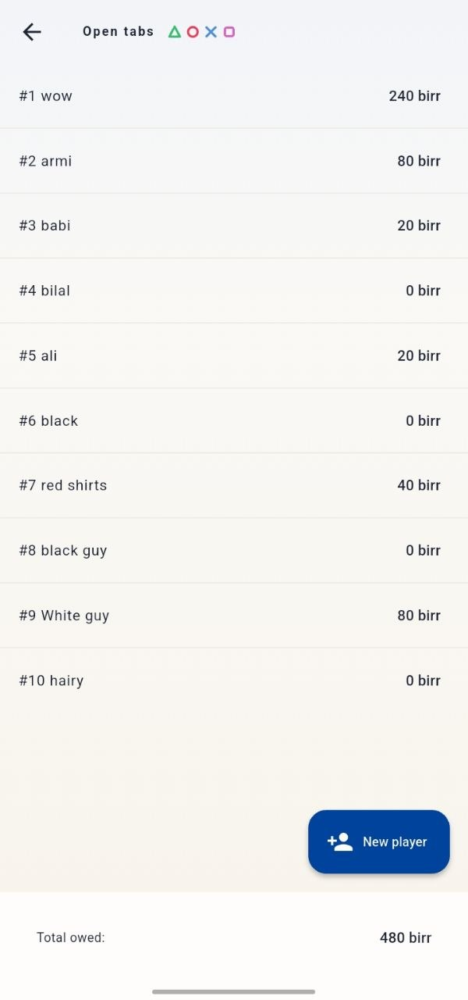
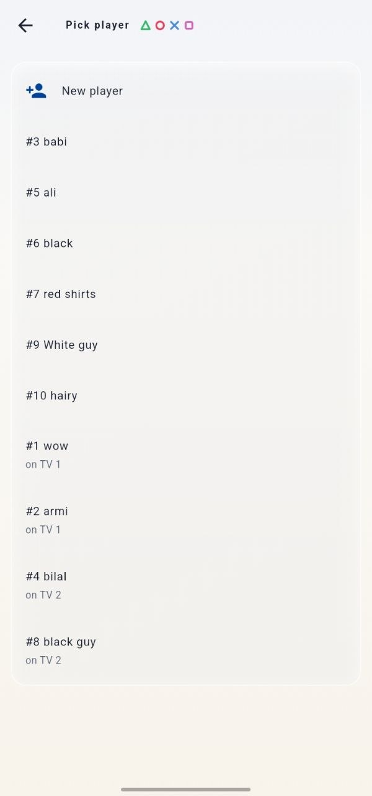
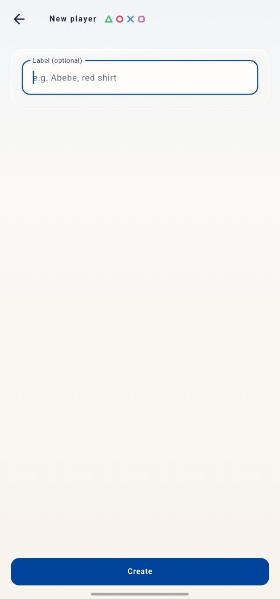
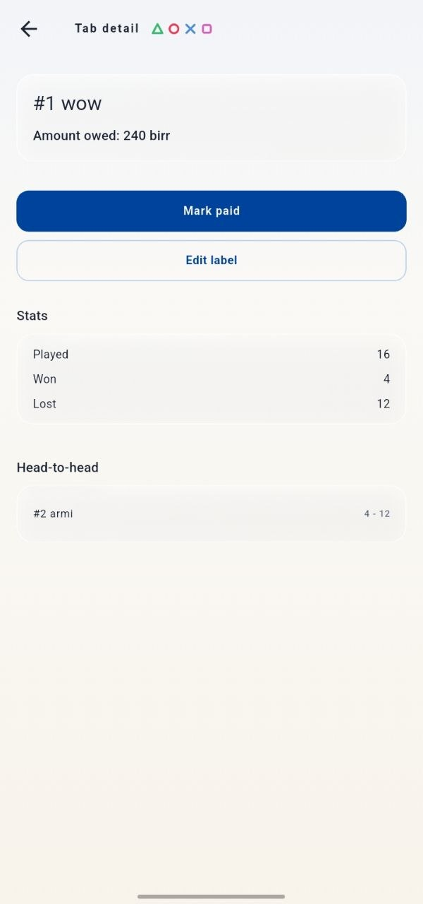
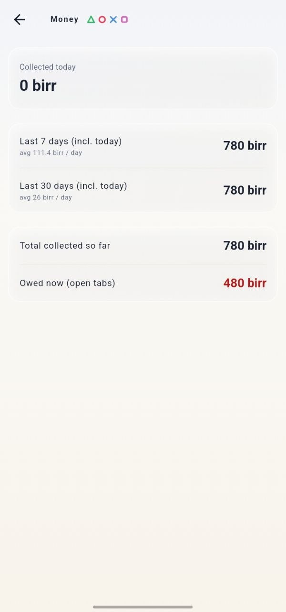
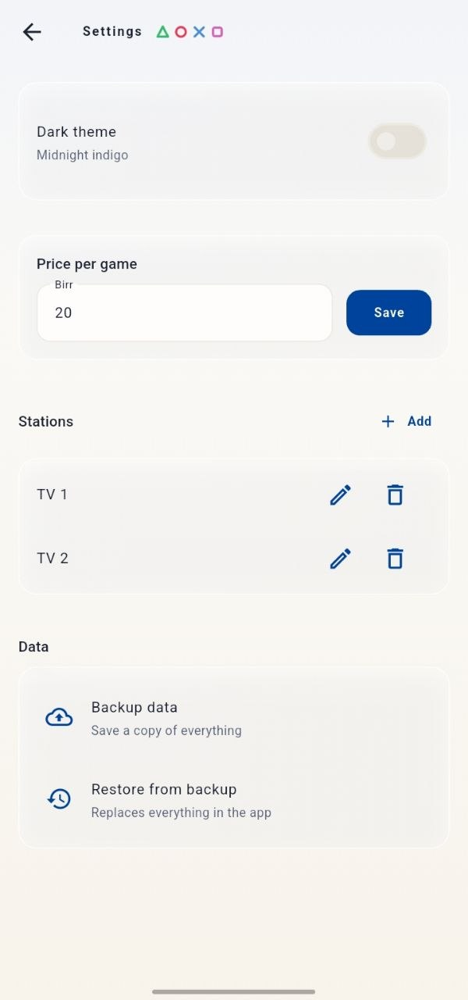
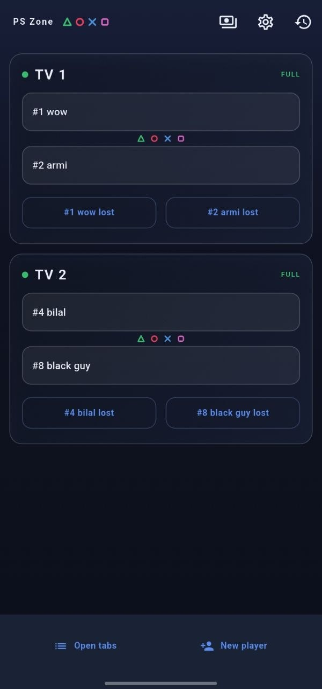

# PS Zone Game Tracker

**The game-night ledger for PlayStation station bars — who lost, who owes, how much you made today. One phone, no internet, zero friction for players.**

Built for a real PlayStation station owner: customers pay per game they lose, several TVs run at once, and everything used to be tracked in his head.

---

## The problem

My friend runs PlayStation stations: customers come, play FIFA, and the loser pays a fixed price per game. Sounds simple — until you watch a busy evening:

- **Counting is mental math.** Two players sit for an hour → "how many games was that? how much is that?" he is counting mid-welcome to the next customer. Phones come out, results get argued about.
- **Nobody remembers the score of the day.** "He lost like 8 games... or was it you?" — the answer really depends on whose memory is sharper.
- **Debts evaporate.** A player who owes money leaves promising to pay "next time". Three days later, nobody — including the owner — remembers who owed what or how much. That money is simply gone.
- **The station is the customer's place of fun.** Asking customers to calculate, count or track anything kills the vibe. Players want to sit and play; all of the accounting pressure lands on the owner alone.
- **"How much did I earn today?"** At closing time, the owner's answer — was it a good day or a slow one? — was pure guesswork.

He was doing the job of a cashier, a referee and a bookkeeper — at the same time, alone, at peak hours. I watched him struggle many times, so I built this app to take the whole bookkeeping off his head.

## What it solves, screen by screen

| The struggle | What the app does |
|---|---|
| "Who is playing on TV 3? Is that seat free?" | **Home screen** — every TV as a card, each with its two live seats. One glance answers it. |
| "Abebe lost… let me count… 4 games so far… 60 birr" | Tap **`#4 Abebe lost`** on the losing player's seat the moment a game ends. The price is recorded automatically, instantly. |
| "Who owes me what right now?" | Every player has a **live tab**. The **Open tabs** screen lists each player and the exact amount they owe — always current. |
| "Did he pay me earlier, or not?" | Every payment is recorded. **Mark paid** settles a tab; **Keep open** collects the money while the player keeps playing. |
| "We tapped the wrong loser!" | Full **Game history** with one-tap **undo**. Mistakes cost one tap, not an argument. |
| "Who always beats Abebe?" | Per-player **stats** and a **head-to-head** record. The regulars love this one. |
| "How much did I make today? This week?" | The **Money screen**: collected today, last 7 days, last 30 days, per-day averages, lifetime total — and exactly how much is still out there with players. |
| "Player #4 quit, the next guy wants #4" | Player numbers are **recycled automatically** when someone's tab closes. |
| "Phone, be careful… my whole ledger is on it" | One-button **backup / restore**: snapshot the data and share it anywhere (Files, Drive, a message to yourself), or restore it back. |
| "White glare at night, dark shadow at day" | **Light & dark themes** (glass + PlayStation-inspired), toggle in settings, choice is remembered. |

### In action

<p>
  
  
  
  
</p>
<p>
  
  
  
  
</p>

## Principles I designed around

- **Offline-first.** No account, no server, no internet. A game night must never depend on connectivity. All data lives in a local SQLite database.
- **The owner is the user — alone.** Every flow is one hand, one thumb, seconds per action: seat a player, tap the loser, get back to the counter.
- **Customers touch nothing.** No PINs, no menus, no calculation on the player side — they just play.
- **No hidden crashes mid-evening.** Errors surface as dismissable snacks; flows recover instead of dead-ending. Backed by an automated test suite (34 tests) covering the money math, undo, undo mistakes, restore safety and screen-recovery flows.

## Tech

- **Flutter** (Material 3, custom glass design system — light & dark)
- Layered architecture: `data → domain → presentation`, **flutter_bloc**, **sqflite** (SQLite), **get_it** DI
- Single-file SQLite store with versioned migrations (schema v3)
- Backup via `VACUUM INTO` snapshots; restore is file-replace with safety checks
- 34 automated tests (`flutter test`), including real-SQLite integration tests

## Status

v1.0 — in daily use by an active PlayStation station owner.

## Getting started

```bash
flutter pub get
flutter run            # debug on a device/emulator
flutter test           # run the test suite
```

Requires a device or emulator with SQLite (physical Android/iOS device recommended) — the app is meant to live on one shop phone.
